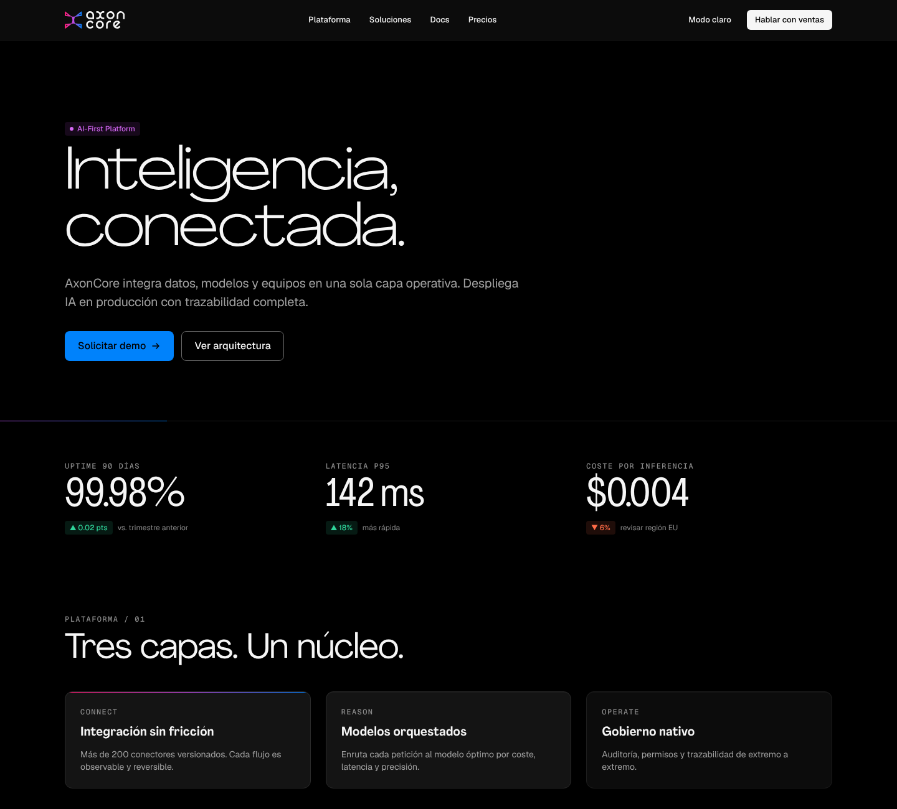

# AxonCore Design System

Sistema de diseño oficial de **AxonCore**: identidad, tokens, tipografía, componentes y guías de uso para producto, web, publicidad y artefactos generados con IA.

**Dark Core, Signal Spectrum.** El negro de marca sostiene la seriedad y el ticket alto; el espectro Pulse → Synapse → Signal aparece como un impulso, nunca como fondo.



## Contenido

| Carpeta | Qué hay |
|---|---|
| `tokens/axoncore.tokens.json` | **Fuente única de verdad**: color (oscuro + claro), tipografía, espaciado, radios, sombras, gradientes, movimiento, layout |
| `src/` | CSS de componentes y componentes React (sin JSX, sin dependencias) |
| `dist/` | Salidas generadas: CSS, Tailwind v3/v4, tokens JS y DTCG (Figma), React ESM/UMD, tokens para Claude Design |
| `assets/` | Logos SVG maestros (3 versiones × 4 colorways), PNG originales, favicons, patrón Axon |
| `fonts/` | Agrandir (licenciada, WOFF2 + OTF) · Geist + Geist Mono (OFL) |
| `docs/` | Guía de marca completa (fundamentos, logo, color, tipografía, layout, componentes, voz, imagen/IA, implementación, decisiones) |
| `skill/axoncore-brand/` | Skill de Claude con todo el guideline de marca |
| `examples/` | Página showcase con todos los componentes |

## Inicio rápido

```bash
npm run build   # genera dist/ (Node ≥ 18, sin dependencias)
npm run check   # auditoría de contraste WCAG en ambos temas
```

### CSS

```html
<html data-theme="dark">  <!-- dark (defecto) · light · auto -->
<link rel="stylesheet" href="dist/css/axoncore.css">
<body class="ax-root">
  <h1 class="type-hero">IA Generativa para impulsar tu negocio</h1>
  <button class="ax-btn ax-btn--signal ax-btn--lg">Solicitar demo</button>
</body>
```

### React

```jsx
import "@axoncore/design-system/css";
import { Logo, Button, Card, Stat } from "@axoncore/design-system/react";

<Logo lockup="horizontal" height={28} />
<Button variant="primary">Hablar con ventas</Button>
<Stat label="Latencia p95" value="142 ms" delta="18%" trend="up" />
```

### Tailwind

```js
// tailwind.config.js (v3)
module.exports = { presets: [require("@axoncore/design-system/tailwind")] };
```

```css
/* v4 */
@import "tailwindcss";
@import "@axoncore/design-system/css/tokens.css";
@import "@axoncore/design-system/tailwind/axoncore-theme.css";
```

Clases: `bg-canvas`, `bg-raised`, `text-primary`, `text-muted`, `border-default`, `bg-accent`, `text-on-accent`, `font-display`, `text-hero`, `rounded-lg`, `shadow-2`, `bg-signal` (gradiente)…

## Guía de marca

1. [Fundamentos](docs/01-fundamentos.md)
2. [Logo](docs/02-logo.md)
3. [Color](docs/03-color.md)
4. [Tipografía](docs/04-tipografia.md)
5. [Layout y superficies](docs/05-layout-y-superficies.md)
6. [Componentes](docs/06-componentes.md)
7. [Voz y tono](docs/07-voz-y-tono.md)
8. [Imagen y prompts IA](docs/08-imagen-y-prompts-ia.md)
9. [Implementación y Claude Design](docs/09-implementacion-y-claude-design.md)
10. [Registro de decisiones](docs/decisiones.md)

## Contribuir

1. Cambia `tokens/axoncore.tokens.json` o `src/`; nunca edites `dist/` a mano.
2. `npm run build && npm run check`.
3. Registra la decisión en `docs/decisiones.md` y abre un PR. CI repite build y auditoría.

## Licencias

- Código y tokens: propiedad de AxonCore. Uso interno.
- Logos y marca: © AxonCore. Todos los derechos reservados.
- Geist / Geist Mono: SIL Open Font License 1.1 (`fonts/geist/OFL.txt`).
- Agrandir: Pangram Pangram, licencia comercial de AxonCore. Repositorio privado: no redistribuir.
